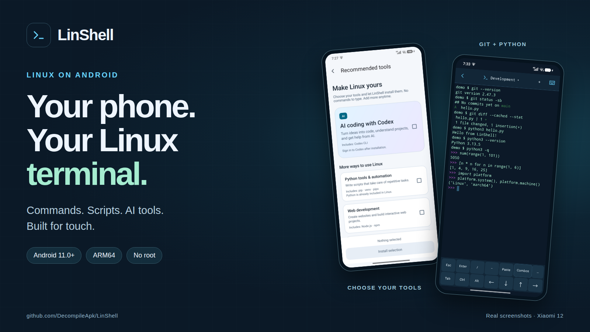
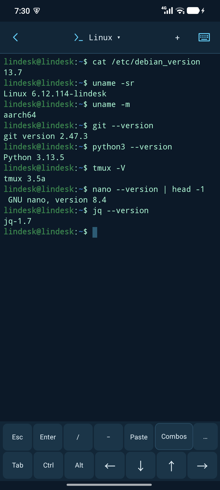
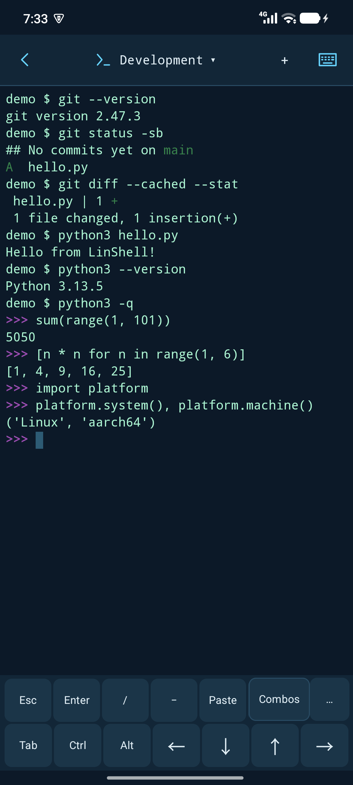
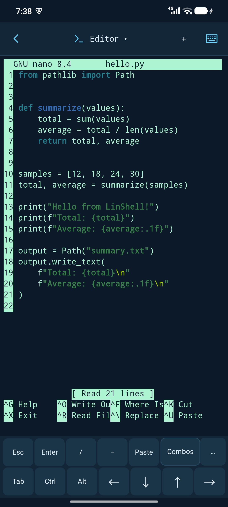
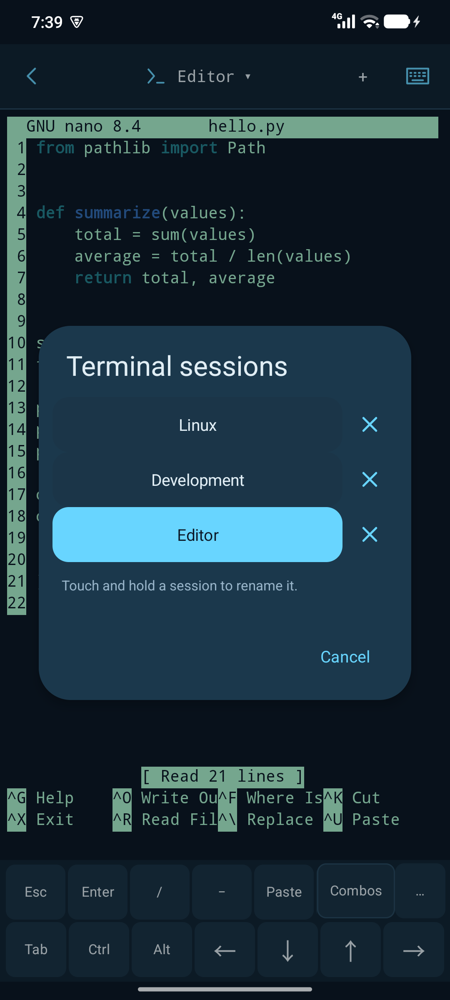
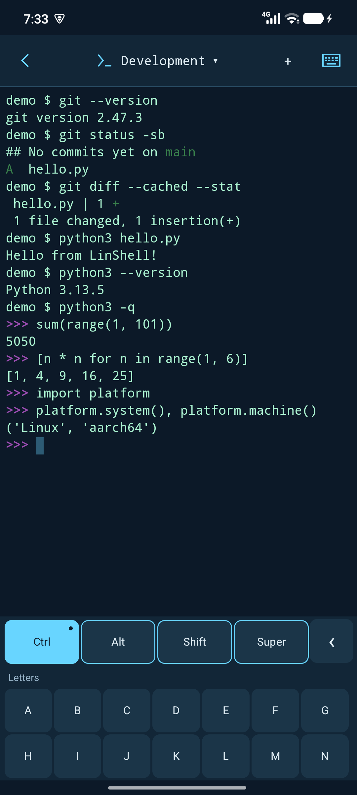
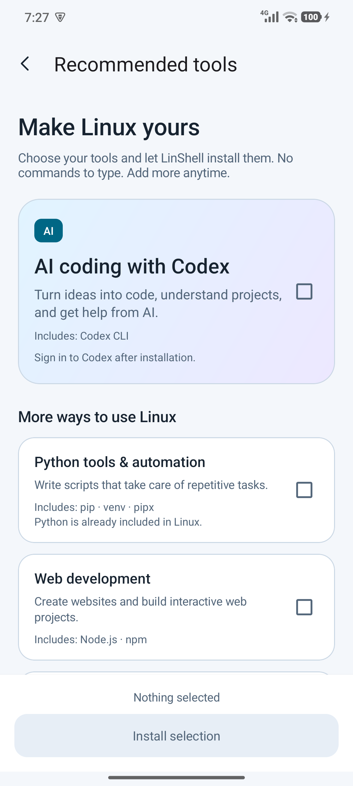

  

# LinShell — Your Linux terminal on Android.

**Commands. Scripts. AI tools. A Linux shell in your pocket.**

Run Debian Linux locally on your Android phone. Work with Git and Python, keep several terminal sessions open, and add the tools you need through a simple visual installer.

  
  &nbsp;
  
  &nbsp;
  
  &nbsp;
  

## A terminal that fits your phone

| Feature | What you get |
| --- | --- |
| **Linux, ready to use** | A local Debian 13 environment. Open LinShell and start a terminal without changing system settings. |
| **Made for touch** | Use your Android keyboard alongside Tab, Ctrl, Alt, Esc and arrow keys. Open **Combos** for more key combinations, or customize the shortcut row. |
| **Multiple terminal sessions** | Open up to eight terminals, give each one a name, and switch between tasks. Sessions share your Linux files and installed tools. |
| **Everyday tools included** | Start with Git, Python, tmux, nano, curl, SSH client, rsync, jq and other command-line essentials. |
| **Development and AI tools** | Add Codex, Python extras, Node.js, Java or Linux build tools from **Settings → Recommended tools**. Choose what you want and let LinShell install it. |
| **Copy and paste with Android** | Select terminal text to copy it, and paste text from your phone into the shell. Scroll through output without opening the keyboard. |

## See it running

Real screenshots from **LinShell on a Xiaomi 12**, with the app in English. Tap an image to enlarge it.

| Linux terminal | Git & Python | Edit scripts |
| :---: | :---: | :---: |
|  |  |  |

| Multiple sessions | Touch shortcuts | Choose your tools |
| :---: | :---: | :---: |
|  |  |  |

## Quick start

> **Download:** Get LinShell on [Google Play](https://play.google.com/store/apps/details?id=linux.on.android.linshell).

1. **Install LinShell** from [Google Play](https://play.google.com/store/apps/details?id=linux.on.android.linshell).
2. **Tap Start terminal.** Allow the first local initialization to finish.
3. **Make it yours.** Run a command, tap **+** to open another terminal, or visit **Settings → Recommended tools** to add more tools.

Git and Python are already included. Optional tools are downloaded when you choose to install them; online services such as AI assistants need an internet connection and their own sign-in.

**[Read the FAQ →](docs/FAQ.md)** · **[Privacy Policy →](privacy.html)**

## Help shape LinShell

Found a bug or have an idea? [Share it in Issues](https://github.com/DecompileApk/LinShell/issues).

If LinShell fits your workflow, star the repository and share it with someone who wants a Linux terminal on Android.
